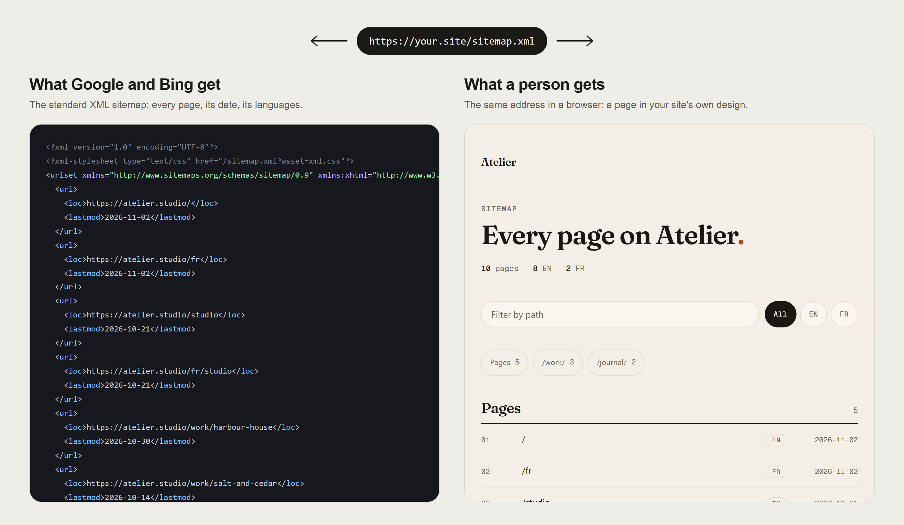

# Maison GR Sitemap for WordPress

**One sitemap, two readers.** Search engines get the XML they need at `/sitemap.xml`. A person who opens the same address gets a page set in your theme's own colours and type, with every page listed, grouped by section and searchable.

[](https://github.com/maison-gr/maisongr-sitemap-wordpress/actions/workflows/ci.yml)
[](LICENSE)




It's the WordPress edition of [maisongr-sitemap](https://github.com/maison-gr/maisongr-sitemap), the sitemap tool for Next.js, Astro, Nuxt and other frameworks. Both render the same page from the same design, and a test checks they match byte for byte.

## What it lists

- The home page, and every published post, page and public custom post type, each dated from its last edit.
- The archive of each category, tag and public taxonomy term in use.
- Each post's featured image, for image search.

It leaves out:

- pages an SEO plugin marks `noindex`: Yoast SEO, Rank Math, SEOPress and The SEO Framework. A sitemap that lists a `noindex` page asks search engines two opposite things;
- password-protected, private and draft posts;
- attachment pages.

## How the two readers are told apart

A browser opening a page sends `Sec-Fetch-Dest: document` and asks for HTML. Crawlers send neither. Those two headers decide which answer is served; no user agent is read. Both answers list exactly the same addresses. The page is `noindex`, cached privately, and `Vary: Sec-Fetch-Dest` keeps any cache from handing one to the other.

The XML also answers `If-None-Match` with `304 Not Modified`, so a crawler skips an unchanged sitemap. Past 50,000 addresses it becomes an index of `?part=N` files.

## What it changes on your site

- WordPress's own sitemap (`/wp-sitemap.xml`) is turned off, and its addresses redirect to `/sitemap.xml` with a 301.
- `robots.txt` names the sitemap, unless the site asks search engines not to index it.
- If Yoast SEO, Rank Math or All in One SEO also makes a sitemap, an admin notice says how to turn theirs off, so search engines read one list.

Deactivating the plugin brings WordPress's own sitemap back.

## Install

The first release, and the listing on WordPress.org, come in December 2026. Until then, build the zip from this repository (`npm ci && npm run zip`, see [Working on the plugin](#working-on-the-plugin)), then in WordPress: **Plugins → Add New Plugin → Upload Plugin**. Activate it, and open `/sitemap.xml`.

Requires WordPress 6.5 or later and PHP 7.4 or later.

## Your theme's look

The page reads your theme's colours and fonts from `theme.json` and the Site Editor's global styles: background, text, links, and the fonts your text and headings are set in, served from your own site. A classic theme gets its custom background colour, if it has one. The accent is used only when it reads at 3:1 on the background; otherwise the text colour stands in for it.

## Languages (beta)

With Polylang or WPML, each translation is linked to the others with `hreflang`, including `x-default`, and the page shows one row per page with its language versions beside it. This is not yet covered by automated tests: tell us if anything looks wrong.

The page itself speaks English or French, following the site's language.

## For developers

Filters:

| Filter | |
|---|---|
| `maisongr_sitemap_entries` | The addresses, after they're read. Each has `loc`, and optionally `lastmod` (`YYYY-MM-DD`), `lang`, `alternates` and `images`. |
| `maisongr_sitemap_post_types` | The post types listed. Default: every public type but attachments. |
| `maisongr_sitemap_taxonomies` | The taxonomies whose term archives are listed. Return `[]` to list none. |
| `maisongr_sitemap_theme` | The look: `name`, `light` palette, `fonts`, `icon`. |
| `maisongr_sitemap_credit` | Whether the page shows its "Made with maisongr-sitemap" line. Default `false`: a credit on the public site is the site owner's choice. |

The list is cached for an hour, and read again whenever content, the theme or the permalinks change.

### Working on the plugin

The plugin is plain PHP in [`maisongr-sitemap/`](maisongr-sitemap). Node is only for development:

```sh
npm ci
npm test       # boots WordPress in WebAssembly (Playground): no PHP or Docker needed
npm run assets # regenerates the page's stylesheet rules and script from maisongr-sitemap
npm run zip    # dist/maisongr-sitemap.zip, ready to upload
```

`WP_PHP=7.4 WP_VERSION=6.5 npm test` runs the tests on other versions.

## Contributing

Issues and pull requests are welcome: see [CONTRIBUTING.md](CONTRIBUTING.md), and report security problems privately ([SECURITY.md](SECURITY.md)).

## License

[MIT](LICENSE), by [Maison GR](https://www.maisongr.com). Other open-source work from the studio: [maisongr-sitemap](https://github.com/maison-gr/maisongr-sitemap) for Next.js, Astro, Nuxt and more, and [maisongr-skills](https://github.com/maison-gr/maisongr-skills) for AI coding agents.
